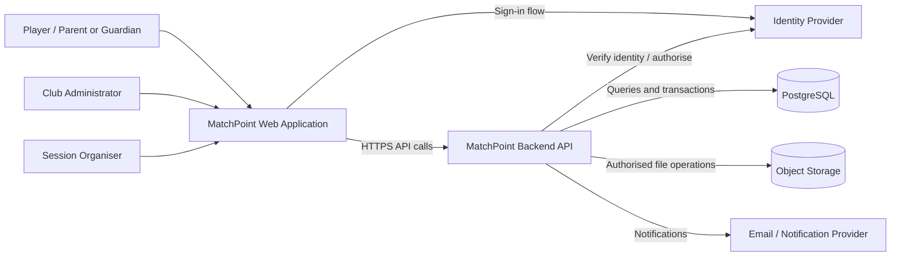
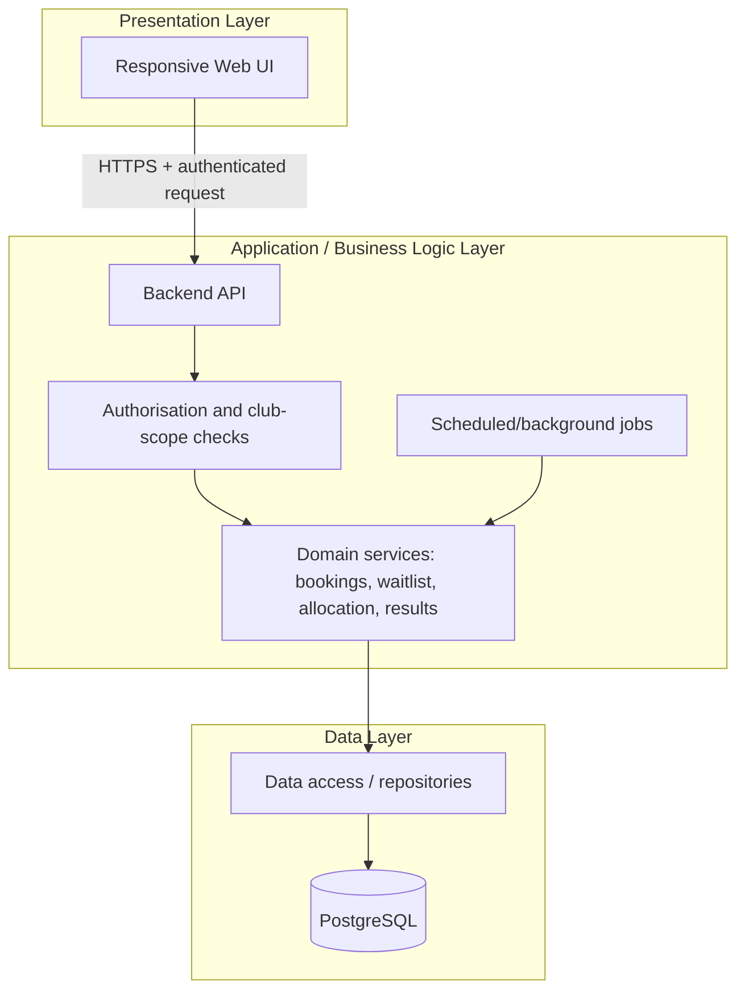
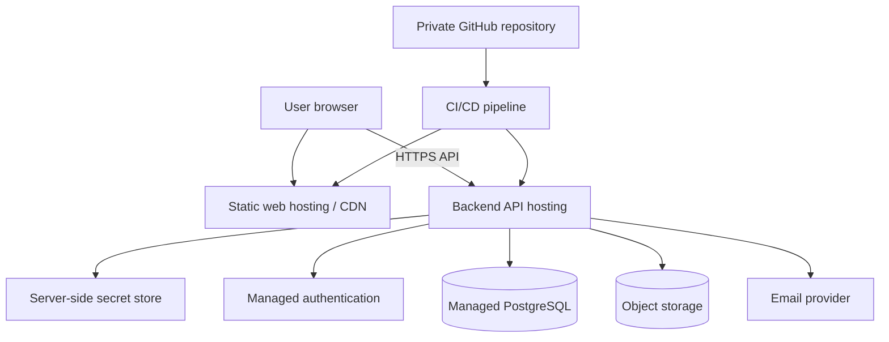
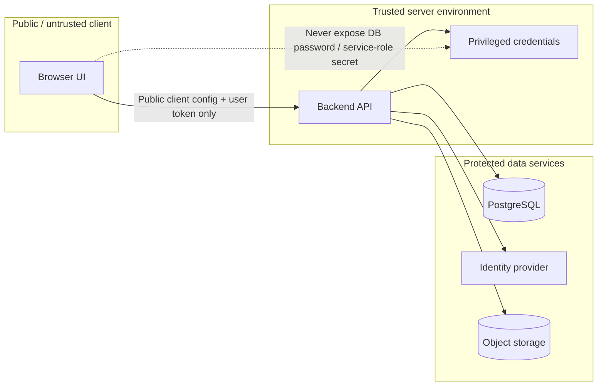

# Project MatchPoint — Architecture Diagram Source (v1.0)

These Mermaid diagrams are source-controlled architecture artefacts. GitHub can render Mermaid in supported Markdown views.

## 1. System context



## 2. Three-layer application architecture



## 3. Session booking sequence

```mermaid
sequenceDiagram
    actor Player
    participant UI as MatchPoint UI
    participant API as Backend API
    participant DB as PostgreSQL
    Player->>UI: Request to book a session
    UI->>API: POST booking request + access token
    API->>API: Validate identity, club role and booking policy
    API->>DB: Begin transaction; check capacity and eligibility
    DB-->>API: Current state / constraint outcome
    API->>DB: Create registration or waitlist entry
    API->>DB: Commit transaction
    API-->>UI: Confirmed / waitlisted / rejected
    UI-->>Player: Display outcome
```

## 4. Deployment topology (provider-neutral)



## 5. Key security boundaries


